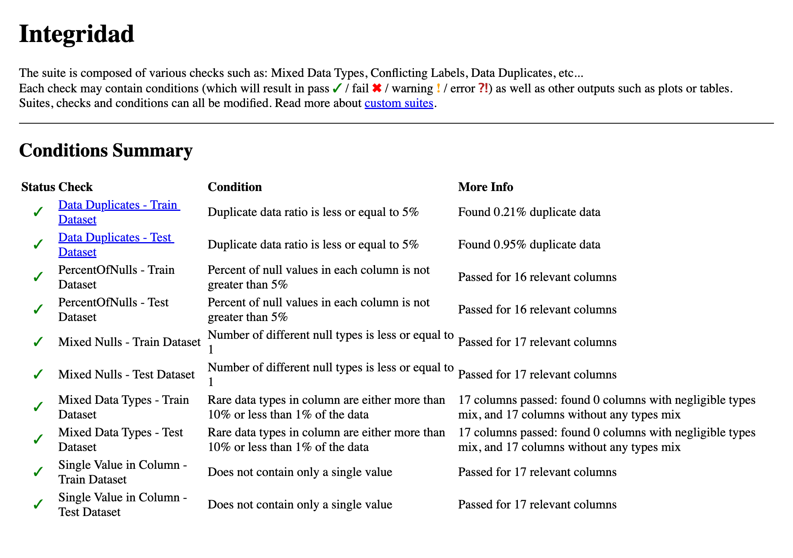
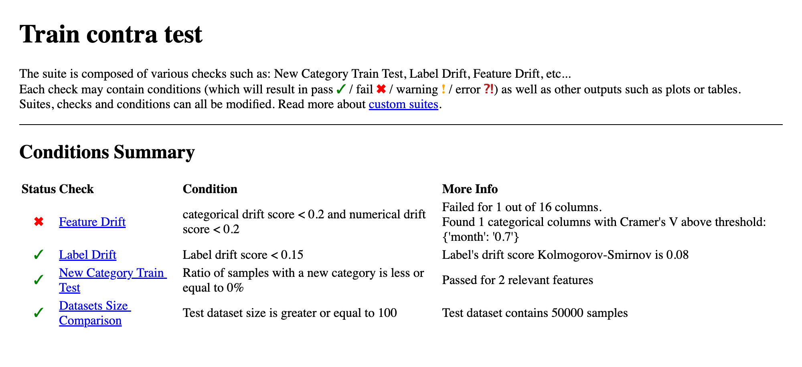
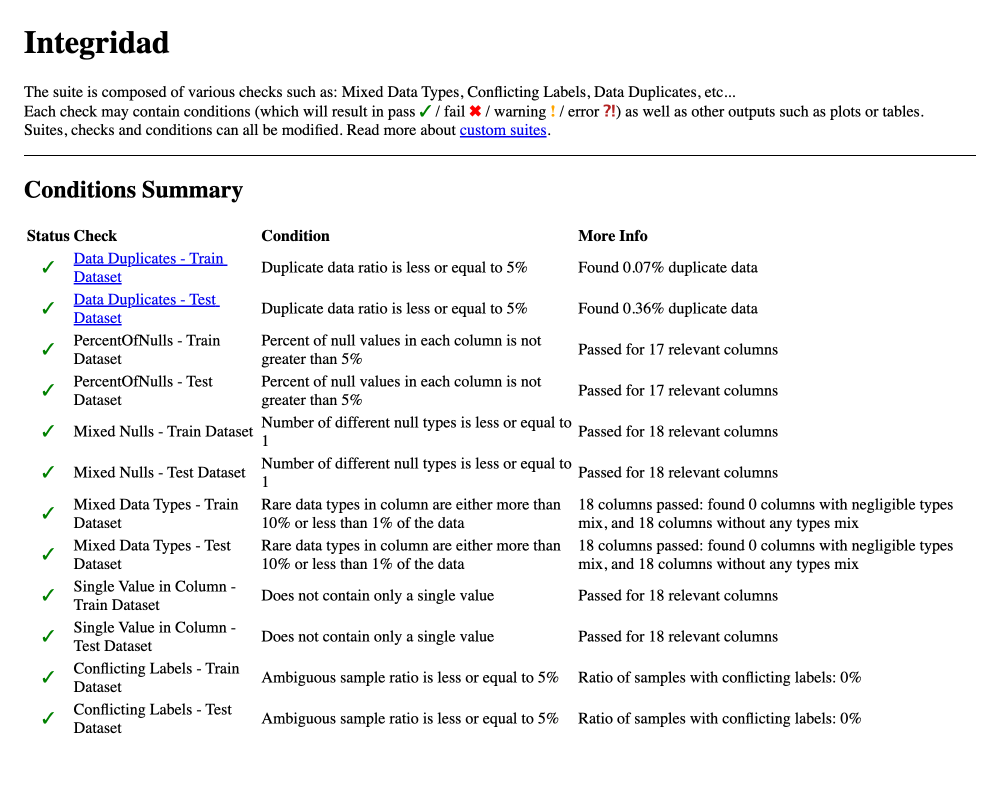
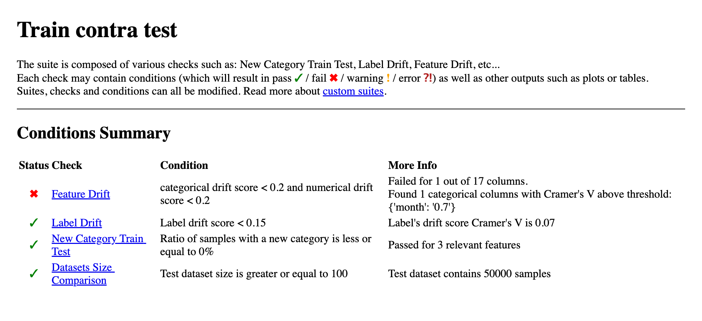
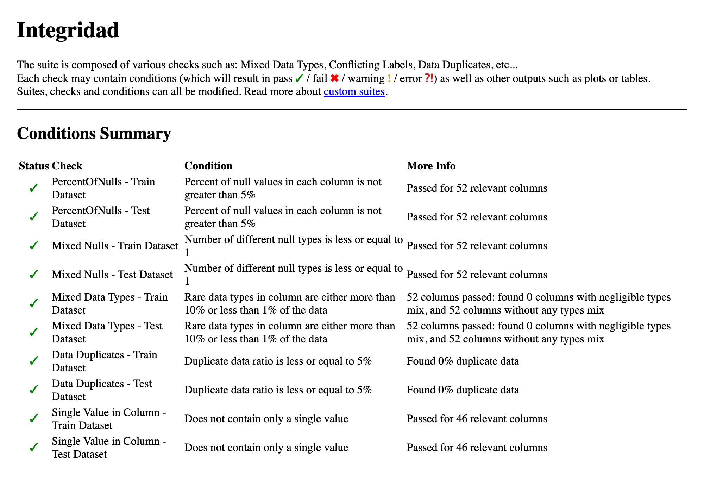
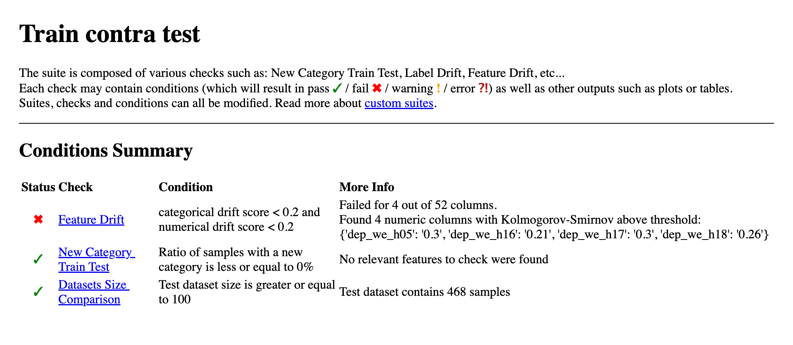

# TC5061-Proyecto-Equipo34 · Proyecto MiBici

<a target="_blank" href="https://cookiecutter-data-science.drivendata.org/">
    
</a>

Propuesta de solución de Machine Learning para la operación de **MiBici**, el sistema de bicicleta pública del Área Metropolitana de Guadalajara. El repositorio tiene la ingesta reproducible y versionada de los viajes, el módulo de feature engineering, un MLflow Project que reproduce los experimentos de las tres preguntas y el Model Registry con el modelo `champion` de cada una. Es la base para las siguientes entregas del proyecto integrador de TC5061.

## Preguntas del proyecto

| # | Pregunta de negocio | Tarea | Formulación del equipo | Usuario |
|---|---|---|---|---|
| P1 | ¿Cuántos viajes se iniciarán en una estación en un periodo futuro? | Regresión | Viajes iniciados por **estación y día**, horizonte **1 día** | Operador del sistema (planeación de flota) |
| P2 | ¿Una estación estará en riesgo de quedarse sin bicicletas o sin anclajes? | Clasificación | Riesgo en el **siguiente bloque de 3 h**: \|llegadas - salidas\| >= 0.5 x capacidad | Equipo de rebalanceo |
| P3 | ¿Qué grupos de estaciones comparten patrones de uso y dónde están? | Clustering | KMeans sobre el **perfil horario de uso** de cada estación (periodo de entrenamiento) | Planeación urbana |

MiBici no publica el inventario por estación. Para P2 el riesgo se aproxima con el flujo neto del bloque: si en 3 horas salen (o llegan) al menos media capacidad de bicicletas más de las que llegan (o salen), una estación con ocupación típica cercana al 50 % se vaciaría (o llenaría) si nadie rebalancea. Detalle en [`references/ml_canvas.md`](references/ml_canvas.md).

## Datos

| Concepto | Valor |
|---|---|
| Fuente | [Portal de datos abiertos de MiBici](https://www.mibici.net/es/datos-abiertos/): `datos_abiertos_AAAA_MM.csv` y `nomenclatura_2026_09.csv` |
| Rango | 2024-01 a 2026-08 (32 meses) |
| Viajes | 12,049,962 crudos · 11,677,716 limpios |
| Estaciones | 484 en el catálogo · 473 con viajes en el rango |
| Versión de datos | `efa3a16661ec` (ver [`data/manifest.json`](data/manifest.json)) |
| Partición temporal | train 2024-01 a 2025-12 · validación 2026-01 a 2026-04 · prueba 2026-05 a 2026-08 |

Condiciones de uso: el portal publica los datos como datos abiertos con la invitación "¡Explora, experimenta y comparte los datos de uso de Mi Bici!", pero no declara una licencia explícita (el sitio indica "Todos los derechos reservados Mi Bici © 2026" y el enlace al "Manual para uso de datos abiertos" no apunta a un manual). Por eso el proyecto usa los datos con fines académicos, cita la fuente, no redistribuye los archivos (cada quien los descarga del portal con la ingesta) y aplica el aviso de privacidad de la Agencia Metropolitana de Servicios de Infraestructura para la Movilidad, regido por la Ley General de Protección de Datos Personales en Posesión de Sujetos Obligados.

Datos personales: la ingesta elimina `Usuario_Id`, `Genero` y `Año_de_nacimiento` antes de guardar cualquier archivo; ninguno de ellos llega a los datasets de modelado ni a MLflow. Los datos de MiBici no se versionan en Git: solo el manifiesto con hashes y conteos.

## Estructura del repositorio

```
├── .github/workflows/ci.yml  <- CI: lint y pruebas en cada Pull Request
├── MLproject              <- MLflow Project: ingest, train, search y register
├── python_env.yaml        <- entorno del MLflow Project (Python 3.12 + requirements.txt)
├── Makefile               <- make mlflow-server | ingest | train | search | register | all | test | validate
├── README.md
├── requirements.txt       <- dependencias con versión fija
├── pyproject.toml         <- metadatos del paquete mibici y configuración de ruff
├── data
│   ├── manifest.json      <- versionado de datos (único archivo de data/ en Git)
│   ├── raw/               <- CSV originales del portal (no versionado)
│   ├── interim/           <- Parquet limpio por mes y estaciones (no versionado)
│   └── processed/         <- datasets de P1, P2 y P3 (no versionado)
├── docs/                  <- propuesta (entrega 1) y reporte de MLflow (entrega 2) en PDF
├── models/                <- modelos serializados (no versionado)
├── notebooks
│   └── 1.0-dfc-exploracion-mibici.ipynb   <- exploración (solo análisis)
├── references
│   ├── ml_canvas.md / .png               <- ML Canvas
│   └── arquitectura.md / .png            <- diagrama de arquitectura
├── reports
│   ├── entrega3-propuestas-oscar.md        <- entrega 3: qué se hizo y qué falta
│   ├── validacion_datos.md                 <- hallazgos de DeepChecks por pregunta
│   ├── deepchecks/        <- reportes HTML de make validate (no versionado)
│   └── figures/           <- capturas de MLflow (mlflow/) y de DeepChecks (deepchecks/)
├── scripts
│   └── run_experiments.sh <- todos los runs de la entrega y el registro de champions
├── tests/                 <- pruebas de ingesta, features, modelado y validación de datos
└── mibici                 <- módulo del proyecto
    ├── config.py          <- rutas, fechas, cortes, semilla y parámetros en un solo lugar
    ├── dataset.py         <- ingesta reproducible y verificación (CLI)
    ├── features.py        <- feature engineering de P1, P2 y P3 (CLI)
    ├── validation.py      <- validación de datos con DeepChecks (CLI)
    ├── plots.py           <- gráficas que se registran como artefactos
    └── modeling
        ├── train.py       <- entrena un modelo (punto de entrada train)
        ├── search.py      <- búsqueda con nested runs (punto de entrada search)
        ├── registry.py    <- Model Registry y alias (punto de entrada register)
        ├── predict.py     <- predicciones de test con el modelo de un alias
        ├── p1.py, p2.py, p3.py  <- tabla de modelos y run de cada pregunta
        ├── tracking.py    <- servidor, experimento, parámetros comunes y etiquetas
        ├── artifacts.py   <- modelo con firma, datos, gráficas y configuración por subcarpeta
        ├── params.py      <- hiperparámetros desde -P params y mallas de búsqueda
        ├── common.py, log_ingest.py
```

## Instalación

Requiere Python 3.12 y Git. El paquete declara `requires-python = "~=3.12.0"`, así que el entorno debe crearse con Python 3.12 explícitamente: si `python` apunta a otra versión (por ejemplo 3.13 o 3.14), la instalación falla.

```bash
git clone https://github.com/diegofalconcostilla/TC5061-Proyecto-Equipo34.git
cd TC5061-Proyecto-Equipo34
python3.12 -m venv .venv                # Windows: py -3.12 -m venv .venv
# Windows: .venv\Scripts\activate      Linux/macOS: source .venv/bin/activate
python --version                        # debe mostrar Python 3.12.x
pip install -r requirements.txt         # instala también el paquete mibici en modo editable
```

Si `pip install` termina con `ERROR: Package 'mibici' requires a different Python: X.Y.Z not in '~=3.12.0'`, el entorno se creó con otra versión de Python: borra `.venv` y vuelve a crearlo con Python 3.12.

Si ya tenías el entorno de la entrega 2, vuelve a correr `pip install -r requirements.txt`: numpy, pandas y scikit-learn bajaron de versión para que funcione DeepChecks (detalle en [Validación de datos](#validación-de-datos)).

## Reproducir el experimento

Todo corre como MLflow Project contra un servidor de tracking local con SQLite. El servidor usa el puerto **5001** porque en macOS el 5000 lo ocupa AirPlay (Receptor AirPlay en Ajustes > General > AirDrop y Handoff). El código lee el servidor de `MLFLOW_TRACKING_URI` (por defecto `http://127.0.0.1:5001`).

```bash
make mlflow-server        # terminal 1: mlflow server --backend-store-uri sqlite:///mlflow.db --port 5001
make all                  # terminal 2: ingesta (~5 min) + todos los experimentos + registro (~6 min)
```

`make all` equivale a `mlflow run . -e ingest` seguido de `scripts/run_experiments.sh`. Comandos sueltos:

```bash
make ingest                                                    # mlflow run . -e ingest
make train Q=p1 M=hgb P="learning_rate=0.1,max_iter=300"        # mlflow run . -e train -P ...
make search Q=p3 M=kmeans G="n_clusters=3|4|5;n_init=10|20"     # mlflow run . -e search -P ...
make register Q=p1                                             # mlflow run . -e register -P question=p1
make predict Q=p1                                              # predicciones de test con el champion
```

**Sin `make` (Windows con Git Bash).** Los mismos pasos con `mlflow run` directo; el script lee `MLFLOW_TRACKING_URI` y `ENV_MANAGER` igual que el Makefile:

```bash
mlflow server --backend-store-uri sqlite:///mlflow.db --port 5001     # terminal 1
export MLFLOW_TRACKING_URI=http://127.0.0.1:5001                      # terminal 2
mlflow run . -e ingest --env-manager uv --experiment-name mibici-equipo34
bash scripts/run_experiments.sh                                       # experimentos y registro
mlflow run . -e train -P question=p1 -P model=hgb -P params="learning_rate=0.1" --env-manager uv --experiment-name mibici-equipo34
```

Por defecto `mlflow run` crea un entorno aislado con `uv` desde `python_env.yaml`. Durante el desarrollo, `ENV_MANAGER=local` usa el entorno activo y es más rápido: `make train ENV_MANAGER=local Q=p2 M=logistica`. Sin `make`, los mismos comandos `mlflow run` funcionan con `--experiment-name mibici-equipo34`.

Si la ingesta produce la misma `data_version` (`efa3a16661ec`), los datos crudos son idénticos a los del experimento reportado. Cada run registra además `train_data_hash`, el hash del dataset de entrenamiento ya construido, porque un cambio en `features.py` modifica los datasets aunque `data_version` no cambie.

**Evidencia oficial:** el `mlflow.db` de cada quien es de pruebas. La evidencia de la entrega sale de una sola corrida de `make all` desde un clon limpio de `main` con el servidor vacío, así todos los runs tienen el mismo commit y `git_dirty=false`. Por eso el registro elige runs por nombre o por métrica, nunca por `run_id`.

### Qué registra cada run

| Tipo | Contenido |
|---|---|
| Etiquetas | `question`, `model_family`, `stage_of_work` (`baseline`, `candidate`, `search`, `ingest`, `register`), `model_role`, `data_version`, `git_commit`, `git_branch`, `git_dirty`, descripción |
| Parámetros | fechas, cortes, semilla, granularidad, horizonte, `data_version`, `train_data_hash` e hiperparámetros |
| `model` | modelo de sklearn con firma e `input_example` (P2 guarda el umbral de decisión dentro del modelo) |
| `data/` | `manifest.json` de la ingesta y `dataset.json` con ruta, hash y tamaño del dataset; también `mlflow.log_input` |
| `plots/` | gráficas de la tarea: serie diaria y real vs. predicho (P1), PR y matriz de confusión (P2), mapa, perfiles y selección de k (P3) |
| `config/` | `run_config.json` con los hiperparámetros resueltos y copia de `config.py` |
| `metrics/` | `metrics.json` y, en P3, la asignación de estaciones a grupos |
| `search/` | en el run padre de una búsqueda: `results.csv` con todas las combinaciones |

Ningún artefacto contiene datos personales: solo agregados por estación y bloque e identificadores públicos de estaciones.

### Model Registry

Un modelo registrado por pregunta: `mibici-equipo34-p1-demanda`, `mibici-equipo34-p2-riesgo` y `mibici-equipo34-p3-grupos`. Cada versión tiene descripción y etiquetas de linaje (`source_run_id`, `git_commit`, `data_version`, `train_data_hash`, métrica de selección y, si viene de una búsqueda, `search_parent_run_id`).

Se usan **aliases** en lugar de stages (MLflow marcó los stages como obsoletos): `champion` es la versión en uso y `challenger` la alternativa en evaluación. `make register Q=p2` elige el mejor run `candidate` o `search` con modelo según la métrica de validación de `SELECTION_METRIC` en `config.py` (P1 `valid_wape`, P2 `valid_pr_auc`, P3 `train_profile_silhouette`); `make register Q=p2 RUN=<run_name> ALIAS=challenger` fija uno concreto. Después de asignar el alias, el registro carga `models:/<nombre>@<alias>` y predice el ejemplo de entrada; si falla, el registro falla.

Versiones en producción (corrida oficial; justificación en [`docs/TC5061_Reporte_MLFlow_Equipo34.pdf`](docs/TC5061_Reporte_MLFlow_Equipo34.pdf)):

| Modelo registrado | `@champion` | `@challenger` |
|---|---|---|
| `mibici-equipo34-p1-demanda` | v1 · `p1-hgb-regressor-lags-calendario[learning_rate=0.1]` | v2 · `p1-random-forest-lags-calendario` |
| `mibici-equipo34-p2-riesgo` | v1 · `p2-hgb-classifier-flujos-lag[learning_rate=0.1]` | v2 · `p2-random-forest-flujos-lag` |
| `mibici-equipo34-p3-grupos` | v1 · `p3-kmeans-perfiles-uso` (k = 3) | v2 · `p3-birch-perfiles-uso` |

En P1 y P2 el champion es la mejor candidata por la métrica de validación y el challenger, la mejor de otra familia. En P3 la mejor silueta es de la mezcla gaussiana, pero su asignación es inestable entre periodos (ARI 0.30 con covarianza diagonal y 0.01 con completa), así que `scripts/run_experiments.sh` fija el champion en KMeans k = 3 (ARI 0.45) y el challenger en Birch (ARI 0.53).

### Cómo agregar un modelo

1. En `mibici/config.py`, agrega sus hiperparámetros por defecto en `P1_MODEL_PARAMS` (o P2, P3).
2. En `mibici/modeling/pN.py`, escribe la función `(parts, hp) -> ModelResult` siguiendo las existentes (devuelve `estimator` y `features` para que se guarde el modelo) y agrégala a la tabla `PN_MODELS` con su `ModelSpec(fit, familia, "candidate", defaults)`.
3. Pruébala: `make train ENV_MANAGER=local Q=pN M=<nombre>` y `make search ... G="..."`.
4. Agrega sus líneas `train` o `search` en la sección de su pregunta de `scripts/run_experiments.sh`.

Los runs, artefactos, etiquetas y el registro funcionan sin más cambios.

### Resultados

Experimento `mibici-equipo34`, corrida oficial (64 runs con el mismo commit y `git_dirty=false`). Por pregunta: baselines, candidatas de varias familias y búsquedas con nested runs. Métricas de validación (selección) y de prueba (mayo a agosto de 2026); tablas completas en el reporte.

| Pregunta | Run | Validación | Prueba |
|---|---|---|---|
| P1 | `p1-baseline-naive-estacional-7d` (baseline) | wape 0.258 | mae 7.12 · wape 0.261 |
| P1 | `p1-baseline-media-movil-7d` (baseline) | wape 0.270 | mae 7.14 · wape 0.262 |
| P1 | `p1-baseline-historico-estacion-dia-semana` (baseline) | wape 0.242 | mae 8.11 · wape 0.298 |
| P1 | `p1-poisson-lineal-lags-calendario[alpha=0.1]` (mejor lineal) | wape 0.197 | mae 5.97 · wape 0.219 |
| P1 | `p1-ridge-lags-calendario` | wape 0.214 | mae 6.36 · wape 0.233 |
| P1 | `p1-random-forest-lags-calendario` (challenger) | wape 0.180 | mae 5.40 · wape 0.198 |
| P1 | `p1-hgb-regressor-lags-calendario[loss=squared_error]` | wape 0.179 | mae 5.41 · wape 0.198 |
| P1 | **`p1-hgb-regressor-lags-calendario[learning_rate=0.1]` (champion)** | **wape 0.176** | **mae 5.33 · wape 0.196** |
| P2 | `p2-baseline-persistencia-semanal` (baseline) | pr_auc 0.397 | pr_auc 0.388 · f1 0.350 |
| P2 | `p2-baseline-tasa-historica-estacion-bloque` (baseline) | pr_auc 0.376 | pr_auc 0.315 · f1 0.335 |
| P2 | `p2-logistica-flujos-lag` | pr_auc 0.405 | pr_auc 0.405 · f1 0.414 |
| P2 | `p2-random-forest-flujos-lag` (challenger) | pr_auc 0.452 | pr_auc 0.443 · f1 0.431 |
| P2 | **`p2-hgb-classifier-flujos-lag[learning_rate=0.1]` (champion)** | **pr_auc 0.483** | **pr_auc 0.462 · f1 0.442 · recall 0.454** |
| P3 | `p3-baseline-kmeans-geografico` (baseline) | silueta -0.014 | — |
| P3 | `p3-baseline-regla-manana-tarde` (baseline) | silueta 0.051 | ari 0.271 |
| P3 | `p3-minibatch-kmeans-perfiles-uso` | silueta 0.086 | ari 0.470 |
| P3 | `p3-birch-perfiles-uso` (challenger) | silueta 0.122 | ari 0.532 |
| P3 | `p3-gaussian-mixture-perfiles-uso[covariance_type=diag]` | silueta 0.160 | ari 0.305 |
| P3 | **`p3-kmeans-perfiles-uso` (champion, k = 3)** | **silueta 0.142** | **ari 0.446** |

En P3 la "validación" es la silueta en el espacio de perfiles de entrenamiento y la columna de prueba es el ARI de estabilidad entre los perfiles de entrenamiento y los de 2026.

El baseline histórico de P1 es el mejor de los tres baselines en validación (MAE 7.42 frente a 7.91 y 8.27) y el peor en prueba: el promedio de 2024-2025 representa cada vez peor la demanda de 2026 (deriva). El ARI del baseline geográfico de P3 es 1.0 por construcción (las coordenadas no cambian entre periodos), por eso no se reporta como estabilidad.

Las cifras de P2 cambiaron ligeramente respecto a la primera entrega: el [PR #12](https://github.com/diegofalconcostilla/TC5061-Proyecto-Equipo34/pull/12) ajustó `block_start` en `features.py` y los bloques que empiezan antes de las 06:00 ya no entran al dataset de P2 (la prevalencia de riesgo en prueba pasó de 0.0252 a 0.0246). `data_version` no cambió porque solo cubre los datos crudos; para detectar estos casos cada run registra ahora `train_data_hash`.

**Nota sobre P2:** los clasificadores se entrenan con `class_weight="balanced"`, así que su `predict_proba` no es una probabilidad calibrada: en prueba, la probabilidad media predicha por el candidato es 0.17, frente a una prevalencia real de riesgo de 0.025. El score sirve para ordenar estaciones por riesgo (PR-AUC, y F1 con el umbral elegido en validación), no para comunicar "X % de riesgo" (van den Goorbergh et al., 2022). Si se necesitan probabilidades, por ejemplo para decidir con costos, hay que calibrar con el periodo de validación o entrenar sin pesos.

## Validación de datos

Antes de entrenar se puede revisar la calidad de los datasets de P1, P2 y P3 con [DeepChecks](https://docs.deepchecks.com/stable/tabular/index.html). Requiere haber corrido la ingesta (`make ingest`) y no necesita el servidor de MLflow:

```bash
make validate                                # P1, P2 y P3 (unos 15 segundos)
python -m mibici.validation --question p2    # solo una pregunta
```

Se validan las mismas columnas que usa cada modelo, con una muestra fija de 50,000 filas por conjunto (`VALIDATION_SAMPLE_SIZE` y `SEED` en `config.py`). Por pregunta corren dos suites y cada una guarda un reporte HTML en `reports/deepchecks/` (no se versiona; ábrelo con el navegador):

| Suite | Chequeo | Condición para pasar |
|---|---|---|
| Integridad (train y test por separado) | `PercentOfNulls` | hasta 5 % de nulos por columna |
| | `MixedNulls` | una sola forma de faltante por columna |
| | `MixedDataTypes` | un solo tipo de dato por columna |
| | `DataDuplicates` | hasta 5 % de filas repetidas |
| | `IsSingleValue` | ninguna columna constante |
| | `ConflictingLabels` | hasta 5 % de filas iguales con etiqueta distinta (solo P2) |
| Train contra test | `FeatureDrift` | drift de cada feature menor a 0.2 (KS o V de Cramer) |
| | `LabelDrift` | drift de la etiqueta menor a 0.15 (P1 y P2) |
| | `NewCategoryTrainTest` | ninguna categoría nueva en test |
| | `DatasetsSizeComparison` | test con al menos 100 filas |

Si falla un chequeo de integridad, el comando termina con error. El drift solo se reporta como aviso: la partición es temporal (2024-2025 contra 2026) y un cambio de distribución es esperado; se documenta en vez de bloquear. Hallazgos por pregunta en [`reports/validacion_datos.md`](reports/validacion_datos.md).

Para leer un reporte, empieza por la tabla *Conditions Summary*: ✓ pasó, ✖ no pasó, y la columna *More Info* dice qué columna y con qué valor. Más abajo vienen las gráficas de cada chequeo.

| Integridad de P1 | Train contra test de P1 |
|---|---|
|  |  |
| **Integridad de P2** | **Train contra test de P2** |
|  |  |
| **Integridad de P3** | **Train contra test de P3** |
|  |  |

`tests/test_validation.py` comprueba con tablas sintéticas que las suites detectan nulos, duplicados, columnas constantes y drift, así que corre con `make test` sin los datos de MiBici.

**Versiones.** DeepChecks 0.19.1 (la última) usa `np.Inf` y el scorer `max_error`, que ya no existen en numpy 2 ni en scikit-learn 1.6 o posterior. Para tener un solo entorno, `requirements.txt` fija numpy 1.26.4, pandas 2.2.3, scikit-learn 1.5.2 y scipy 1.14.1. Con estas versiones 14 de los 18 modelos dan exactamente las mismas métricas; los otros 4 cambian en la tercera o cuarta cifra decimal y ningún champion cambia (detalle en [`reports/entrega3-propuestas-oscar.md`](reports/entrega3-propuestas-oscar.md)).

## Buenas prácticas aplicadas

| Práctica | Cómo se aplica |
|---|---|
| Un experimento por proyecto y runs con nombre descriptivo | Todos los runs van a `mibici-equipo34`; cada uno tiene nombre `pN-<modelo>-<variables>` y una descripción. |
| Registrar lo necesario para reproducir | Parámetros `date_start`, `date_end`, `data_version`, `train_data_hash`, `valid_start`, `test_start`, `seed`, granularidad, horizonte, modelo e hiperparámetros; modelo con firma, datos y configuración como artefactos. |
| Ligar el run al código y a la pregunta | Etiquetas `team`, `question`, `model_role`, `model_family`, `stage_of_work`, `git_commit`, `git_branch` y `git_dirty`. |
| Métricas con el conjunto en el nombre | `valid_mae`, `test_mae`, `test_pr_auc`, `train_profile_silhouette`, `test_stability_ari`, etc. |
| Sin credenciales ni datos personales | No hay credenciales en el código; las columnas personales se eliminan en la ingesta; los artefactos solo contienen agregados e identificadores públicos de estaciones. |
| Notebooks solo para exploración | `notebooks/1.0-dfc-exploracion-mibici.ipynb` sigue la convención de la plantilla; la lógica vive en `mibici/`. |
| Configuración en un solo lugar | Rutas, fechas, cortes, semilla, umbrales, hiperparámetros por defecto, métricas de selección y nombres del Model Registry en `mibici/config.py`. |
| Experimento reproducible de punta a punta | MLflow Project con entorno fijo (`python_env.yaml`) y `make all` desde un clon limpio. |
| Dependencias fijas | `requirements.txt` con `==` en todas las dependencias. |
| Nada de datos, modelos ni MLflow en Git | `.gitignore` excluye `data/*` (salvo el manifiesto), `*.csv`, `*.parquet`, `mlruns/`, `mlartifacts/`, `mlflow.db`, `models/*`, modelos serializados y `.env`. |
| Cambios por Pull Request revisado | `main` protegida: no admite push directo, ni siquiera de administradores. |
| Integración continua | GitHub Actions corre `make lint` y `make test` en cada Pull Request (`.github/workflows/ci.yml`). |
| Sin fuga de información del futuro | Lags con `shift` >= horizonte (validado en `add_lag_features` y en `tests/`), partición temporal y perfiles de P3 calculados solo con train. |

## Flujo de trabajo con Git

Seguimos **GitHub Flow**:

1. `main` está protegida: todo cambio entra por Pull Request, con conversaciones resueltas y sin force push.
2. Cada cambio se hace en una rama corta creada desde `main`.
3. Se abre un Pull Request con descripción y forma de probar, otro integrante lo revisa y después se hace merge. La rama se borra al hacer merge.

**Nombres de ramas:** `<tipo>/<descripcion-corta>`, por ejemplo `feat/ingesta-reproducible`, `fix/encabezados-latin1`, `docs/readme-propuesta`.

**Commits:** [Conventional Commits](https://www.conventionalcommits.org/es/v1.0.0/): `<tipo>(<ámbito opcional>): <descripción en imperativo>`. Tipos: `feat`, `fix`, `docs`, `chore`, `refactor`, `test`, `style`. Ejemplo: `feat(dataset): ingesta reproducible con manifiesto de versionado`.

**Revisiones:** cada integrante abre al menos un Pull Request y revisa al menos uno de otro integrante.

## Integrantes y roles

| Integrante | Rol |
|---|---|
| Diego Falcón Costilla | Ingesta y versionado de datos, experimento base en MLflow |
| Oscar Elton | Modelos intermedios (antes de los boostings) y refactorización de código |
| Mariana Favarony Avila | MLOps & Experiment Validation|
| Javier Alejandro García | Feature Engineering |

## Referencias

- Dorard, L. (2018, 9 de marzo). *From data to AI with the Machine Learning Canvas (Part I)*. Own Machine Learning. Medium.
- Huyen, C. (2022). *Designing machine learning systems: An iterative process for production-ready applications*. O'Reilly Media.
- MiBici. (s.f.). *Datos abiertos* [Conjunto de datos]. Sistema de Bicicleta Pública del Área Metropolitana de Guadalajara. https://www.mibici.net/es/datos-abiertos/
- MLflow. (s.f.). *MLflow Model Registry* [Documentación]. https://mlflow.org/docs/latest/ml/model-registry/
- MLflow. (s.f.). *MLflow Projects* [Documentación]. https://mlflow.org/docs/latest/ml/projects/
- MLflow. (s.f.). *MLflow Tracking* [Documentación]. https://mlflow.org/docs/latest/ml/tracking/
- Treveil, M., Omont, N., Stenac, C., Lefevre, K., Phan, D., Zentici, J., Lavoillotte, A., Miyazaki, M., & Heidmann, L. (2020). *Introducing MLOps: How to scale machine learning in the enterprise*. O'Reilly Media.
- van den Goorbergh, R., van Smeden, M., Timmerman, D., & Van Calster, B. (2022). The harm of class imbalance corrections for risk prediction models: Illustration and simulation using logistic regression. *Journal of the American Medical Informatics Association, 29*(9), 1525-1534. https://doi.org/10.1093/jamia/ocac093
- Wilson, B. (2022). *Machine learning engineering in action*. Manning Publications.
