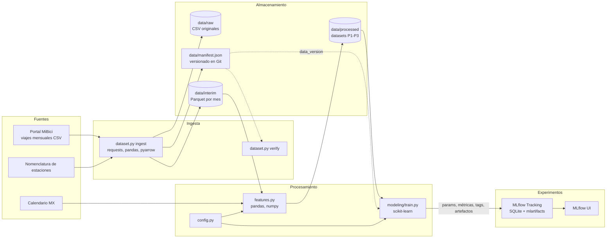

# Arquitectura del sistema - Proyecto MiBici (Equipo 34)

Versión gráfica: [`arquitectura.png`](arquitectura.png).

| Componente | Herramienta | Justificación |
|---|---|---|
| Ingesta | `requests`, `pandas`, CLI con `typer` | Un solo comando sin pasos manuales reconstruye los datos; el portal cambia codificación y encabezados entre meses, así que la normalización se hace en código y no a mano (Huyen, 2022, cap. 3). |
| Almacenamiento | Parquet (`pyarrow`, zstd) | Formato columnar y tipado: 981 MB de CSV quedan en 172 MB y se leen solo las columnas necesarias (Huyen, 2022, cap. 3). |
| Versionado de datos | Manifiesto JSON con SHA-256 en Git | Liga cada resultado con la versión exacta de los datos sin subir datos al repositorio; la `data_version` se registra en MLflow (Treveil et al., 2020, cap. 3; Huyen, 2022, cap. 6). |
| Procesamiento | `pandas`, `numpy` en `features.py` | Funciones reutilizables y probadas en lugar de celdas de notebook; evitan fuga temporal con desplazamientos explícitos (Huyen, 2022, cap. 5; Wilson, 2022). |
| Entrenamiento | `scikit-learn` | Baselines simples y modelos de gradient boosting y KMeans con una API común; primero un baseline y luego el modelo complejo (Wilson, 2022; Huyen, 2022, cap. 6). |
| Registro de experimentos | MLflow Tracking (SQLite) | Parámetros, métricas, artefactos y commit de cada run en un solo lugar para comparar y reproducir (MLflow, s.f.; Treveil et al., 2020). |
| Colaboración | Git, GitHub Flow, Cookiecutter Data Science | Estructura estándar, revisión por Pull Request y rama principal protegida (Treveil et al., 2020; Wilson, 2022). |
