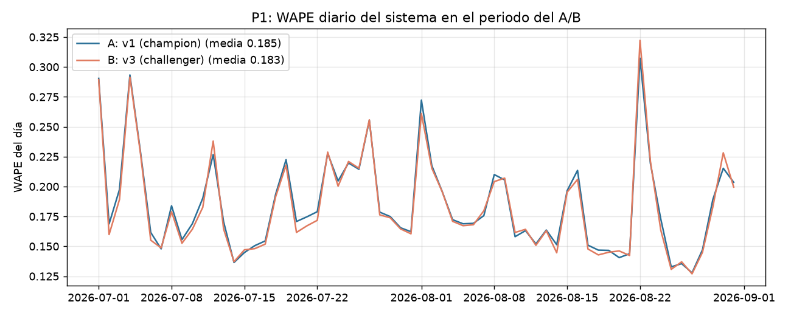

# Análisis de Data Drift y A/B testing del modelo P1 – MiBici

## 1. Objetivo

Analizar los cambios en los datos utilizados por el modelo P1 de predicción de demanda de MiBici, revisar la calidad del conjunto actual y comparar el desempeño del modelo vigente (*champion*, versión 1) frente a una alternativa reentrenada (*challenger*, versión 3). Con base en la evidencia, presentamos una recomendación sobre la promoción del modelo y la estrategia de *Continuous Training*.

## 2. Datos y periodos utilizados

El análisis de monitoreo compara tres conjuntos:

| Conjunto | Periodo | Registros estación-día | Uso |
|---|---|---:|---|
| Referencia de entrenamiento | 2024-01-01 a 2025-12-31 | 262.712 | Datos utilizados para entrenar el modelo champion |
| Referencia de la misma temporada | 2025-05-01 a 2025-08-31 | 45.580 | Comparación interanual de los mismos meses |
| Periodo actual | 2026-05-01 a 2026-08-31 | 50.561 | Representa el comportamiento más reciente del sistema |

Se utiliza una segunda referencia de mayo a agosto de 2025 para controlar parcialmente el efecto estacional. La comparación directa contra todo el entrenamiento podría señalar diferencias causadas simplemente porque el conjunto de entrenamiento contiene los doce meses del año y el periodo actual solo cuatro.

Para el A/B testing, la versión alternativa se ajustó con datos hasta el 30 de junio de 2026. La evaluación se realizó del 1 de julio al 31 de agosto de 2026, con 27.433 registros de 471 estaciones. Ninguna de las dos versiones utilizó esas fechas para entrenar, por lo que la comparación se realiza sobre un periodo de evaluación independiente.

## 3. Resultados e interpretación del Data Drift

### 3.1. Metodología de detección

El monitoreo se generó con Evidently mediante dos comparaciones: el periodo actual frente al conjunto de entrenamiento y frente a los mismos meses del año anterior. La segunda referencia permite controlar parcialmente la estacionalidad y distinguir los cambios propios de la época del año de otros cambios en la composición o el comportamiento del sistema.

Para las variables numéricas, Evidently utilizó la distancia de Wasserstein normalizada; para las categóricas, la distancia de Jensen-Shannon. De acuerdo con la configuración documentada para estos reportes, se utilizó un umbral de 0,1. Los reportes se generaron con conjuntos de más de 1.000 filas y los valores corresponden a las métricas que presenta Evidently.

### 3.2. Variables con drift

Evidently reportó drift en **12 de 18 variables (66,7 %) frente al entrenamiento** y en **11 de 18 variables (61,1 %) frente a la misma temporada**. La siguiente tabla presenta las variables detectadas en al menos una de las comparaciones y sus valores de drift:

| Variable | Drift vs. entrenamiento | Drift vs. misma temporada | Interpretación |
|---|---:|---:|---|
| `month` | 0,558605 | 0,028471 | La diferencia frente al entrenamiento está asociada principalmente a comparar doce meses con una ventana de cuatro meses. |
| `departures_roll28_mean` | 0,195535 | 0,158121 | Cambios en el promedio móvil de salidas de 28 días. |
| `departures_roll7_mean` | 0,187219 | 0,163821 | Cambios recientes en el promedio móvil de salidas de 7 días. |
| `prediction` | 0,178062 | 0,156421 | Cambios en la distribución de las predicciones del modelo. |
| `departures_lag7` | 0,175324 | 0,151025 | Cambios en las salidas registradas siete días antes. |
| `departures_lag14` | 0,174759 | 0,141055 | Cambios en las salidas registradas catorce días antes. |
| `departures` | 0,171777 | 0,151398 | Cambios en la distribución de salidas. |
| `departures_lag1` | 0,170909 | 0,154527 | Cambios en las salidas del día anterior. |
| `arrivals_roll7_mean` | 0,170634 | 0,146061 | Cambios en el promedio móvil de llegadas de 7 días. |
| `departures_lag2` | 0,167708 | 0,154293 | Cambios en las salidas registradas dos días antes. |
| `arrivals_lag7` | 0,161843 | 0,133344 | Cambios en las llegadas registradas siete días antes. |
| `arrivals_lag1` | 0,157266 | 0,136579 | Cambios en las llegadas del día anterior. |

`month` presenta drift frente al entrenamiento, pero no frente a la misma temporada. Por eso, aunque son 12 las variables detectadas en la primera comparación, son 11 las que también presentan drift al controlar por los mismos meses del año anterior. Las variables de demanda —salidas, llegadas, rezagos y promedios móviles— mantienen diferencias en ambas comparaciones y merecen atención en el monitoreo.

### 3.3. Interpretación e implicaciones para el modelo

El hecho de que 11 variables mantengan drift frente a la referencia de la misma temporada indica que los cambios no se explican únicamente por la diferencia de meses entre los conjuntos. Las variables de rezagos y promedios móviles representan patrones recientes de salidas y llegadas; sus cambios sugieren que esos patrones no tienen la misma distribución que en los periodos de referencia.

Una explicación relevante para los cambios en las variables de demanda es la expansión de la red. Entre los dos veranos comparados, las estaciones con registros pasaron de 371 a 471. Las 100 estaciones nuevas presentan un promedio aproximado de 9,5 salidas diarias, mientras que las estaciones existentes promedian 29,2, frente a 31,9 en el verano de 2025. Por tanto, el drift refleja tanto un cambio en la composición de estaciones como una disminución de demanda en estaciones existentes.

El drift es una señal para investigar y monitorear; por sí solo no demuestra que el modelo haya perdido precisión. Para determinar el impacto predictivo se complementa con la evaluación A/B.

## 4. Calidad de los datos

El resumen de Evidently para el periodo actual presenta:

| Indicador | Resultado |
|---|---:|
| Registros | 50.561 |
| Valores faltantes | 0 (0 %) |
| Columnas vacías | 0 |
| Columnas constantes | 0 |
| Filas marcadas como duplicadas por el reporte | 486 |

No se identificaron valores faltantes, columnas vacías ni columnas constantes. El conteo de 486 filas marcadas como duplicadas requiere interpretación: el reporte no incluye los identificadores `station_id` ni `date`, y la revisión del conjunto original indica que no existen parejas estación-fecha duplicadas. Por ello, el indicador corresponde a filas iguales en las variables incluidas en el reporte, no a duplicados reales de estación-día.

En general, los indicadores disponibles no muestran problemas de valores faltantes o columnas sin información. Se recomienda conservar los identificadores de estación y fecha en las validaciones de unicidad para evitar interpretar incorrectamente el conteo de duplicados.

## 5. Resultados del A/B testing

Se compararon las siguientes versiones:

- **Modelo A – Champion v1:** `p1-hgb-regressor-lags-calendario` (`learning_rate=0.1`).
- **Modelo B – Challenger v3:** `p1-hgb-reentrenado-hasta-2026-06`.

La evaluación se realizó sobre el mismo conjunto de julio y agosto de 2026.

| Métrica | Champion v1 (A) | Challenger v3 (B) | Cambio B − A |
|---|---:|---:|---:|
| MAE | 4,8738 | **4,8207** | -0,0530 |
| RMSE | 8,6650 | **8,3843** | -0,2807 |
| WAPE | 18,02 % | **17,82 %** | -0,20 puntos porcentuales |
| R² | 0,9214 | **0,9265** | +0,0050 |

El challenger obtiene menor MAE, RMSE y WAPE, y un R² mayor. En términos de WAPE, la reducción es de aproximadamente 0,20 puntos porcentuales.

### 5.1. Incertidumbre de la comparación

Se realizó un bootstrap por estación con 2.000 remuestreos. Para la diferencia B − A:

| Métrica | Diferencia | Intervalo de confianza del 95 % | Probabilidad estimada de que B sea mejor |
|---|---:|---:|---:|
| WAPE | -0,0020 | [-0,0036; -0,0004] | 99,75 % |
| MAE | -0,0530 | [-0,0999; -0,0107] | 99,75 % |

Los intervalos de confianza no incluyen cero, lo que respalda una mejora agregada de B en estas métricas. Sin embargo, el modelo B no obtiene menor error en cada registro: el archivo de resultados indica que B tiene menor error en el 49,9 % de los estación-días y A en el 50,1 %. La decisión favorable a B se basa en la magnitud agregada de los errores y en las métricas globales, no en que B gane en todos los casos.

### 5.2. Comportamiento diario

La gráfica `figures/p1_ab_wape_diario.png` muestra la evolución diaria del WAPE entre julio y agosto de 2026. Las dos curvas siguen trayectorias muy cercanas y presentan picos en fechas similares. La leyenda reporta un promedio diario de 0,185 para A y 0,183 para B.

Estos promedios diarios corresponden a la agregación que muestra la gráfica y no deben confundirse con el WAPE global de la tabla anterior, calculado para el conjunto completo de evaluación. En ambos casos, la versión B presenta una ventaja pequeña, aunque consistente en el agregado.

## 6. Análisis por segmentos

La comparación por segmentos permite identificar dónde se concentra la mejora y dónde persisten oportunidades de ajuste.

| Segmento | WAPE A | WAPE B | Cambio reportado del WAPE |
|---|---:|---:|---:|
| Estaciones existentes | 17,41 % | 17,17 % | -1,37 % |
| Estaciones nuevas | 28,68 % | 29,25 % | +1,97 % |
| Días laborables | 16,71 % | 16,47 % | -1,40 % |
| Fines de semana o festivos | 22,54 % | 22,48 % | -0,29 % |

El challenger mejora en estaciones existentes y en ambos tipos de día, aunque la mejora durante fines de semana y festivos es pequeña. En cambio, el WAPE aumenta en estaciones nuevas, de 28,68 % a 29,25 %. Esto es importante porque las estaciones nuevas tienen menos historial y un promedio de demanda inferior al de las estaciones existentes.

Por lo tanto, la mejora global no debe ocultar el desempeño más débil en estaciones nuevas. Se recomienda mantener este segmento bajo seguimiento y evaluar mejoras específicas para estaciones con poco historial.

## 7. Recomendación sobre Continuous Training

Con la evidencia disponible, se recomienda **promover el challenger v3 como nueva versión vigente**, sujeto al proceso de aprobación y despliegue del equipo, porque obtiene mejores métricas globales en un conjunto de evaluación independiente y las diferencias de WAPE y MAE tienen intervalos de confianza del 95 % que no incluyen cero.

También se recomienda implementar una estrategia de monitoreo periódico, pero no activar un reentrenamiento automático ante cualquier señal de drift. Se propone el siguiente flujo de Continuous Training:

1. **Monitorear:** revisar periódicamente la distribución de variables y la calidad de los datos.
2. **Investigar:** confirmar si el drift persiste al comparar contra periodos estacionales equivalentes y analizar posibles causas operativas, como la incorporación de estaciones.
3. **Evaluar desempeño:** cuando existan etiquetas disponibles, revisar las métricas predictivas en datos recientes para determinar si los cambios de distribución afectan la precisión.
4. **Reentrenar y comparar:** si el drift persistente se acompaña de deterioro predictivo o existe una necesidad operativa clara, entrenar un Challenger y evaluarlo frente al Champion con datos independientes.
5. **Decidir la promoción:** considerar las métricas globales y por segmentos, especialmente estaciones nuevas, antes de reemplazar el Champion.

El reentrenamiento debe activarse cuando el drift esté acompañado de evidencia de deterioro del desempeño o de una necesidad operativa clara. Antes de promover cualquier versión, debe comprobarse que mejora las métricas relevantes y que no introduce degradaciones inaceptables en segmentos importantes. En este caso, la mejora global de v3 respalda su promoción, pero el aumento del WAPE en estaciones nuevas justifica mantener un seguimiento específico de ese segmento.

## 8. Conclusiones

El monitoreo detectó cambios en una proporción importante de las variables de P1, incluso al comparar contra los mismos meses del año anterior. La expansión de la red y la reducción de demanda en estaciones existentes son factores que ayudan a explicar estos cambios. La calidad del conjunto actual es adecuada en cuanto a valores faltantes y columnas vacías o constantes; el indicador de filas duplicadas debe interpretarse considerando que el reporte no incluye los identificadores de estación y fecha.

El A/B testing favorece al challenger v3 en las métricas globales y ofrece evidencia estadística de una mejora agregada. No obstante, el desempeño empeora en estaciones nuevas, por lo que la promoción debe acompañarse de monitoreo segmentado. En consecuencia, se recomienda adoptar la versión 3 y establecer un esquema de Continuous Training basado en evidencia de drift, calidad y desempeño, en lugar de reentrenar automáticamente ante cualquier cambio de distribución.

## 9. Evidencias adjuntas

- `evidencia/evidently/p1_drift_entrenamiento.html`: comparación contra el periodo de entrenamiento.
- `evidencia/evidently/p1_drift_misma_temporada.html`: comparación contra la misma temporada del año anterior.
- `evidencia/evidently/p1_drift_resumen.json`: resumen de drift y calidad de datos.
- `evidencia/evidently/periodos.md`: definición y justificación de periodos.
- `evidencia/ab_testing/p1_ab_test.md`: resultados y decisión del A/B testing.
- `evidencia/ab_testing/p1_ab_test.json`: resultados estructurados del A/B testing.
