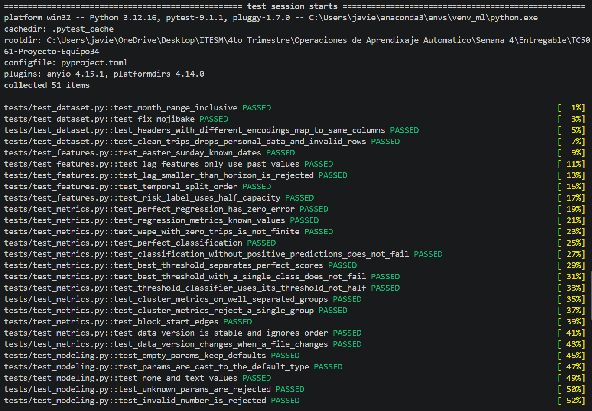
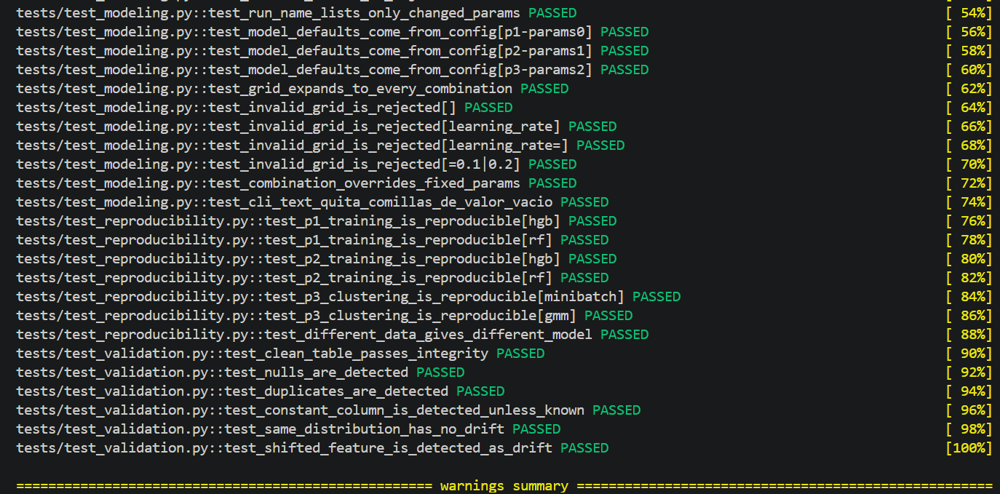
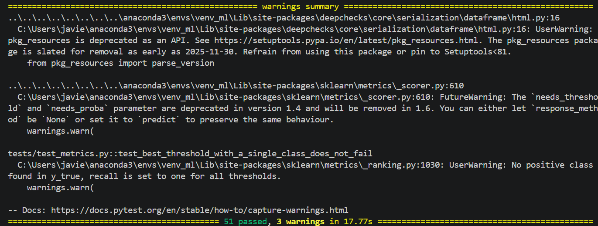

# Reporte de Validación en Entorno Windows - Javier

- **Sistema Operativo:** Windows 11 (Python 3.12.16)
- **Entorno Virtual:** `venv_ml` (Anaconda)
- **Ejecución de Pruebas:**
  - Comando utilizado: `& "C:\Users\javie\anaconda3\envs\venv_ml\python.exe" -m pytest -v`
  - Resultado: **51 passed** (Ejecutado exitosamente en 17.77s).
- **Verificación del Entorno:**
  - Se validó la correcta integración del entorno virtual de MLOps y la compatibilidad del servidor local de MLflow.
- **Conclusión:** El proyecto, la integridad de las pruebas unitarias, contratos de datos, Deepchecks y reproducibilidad funcionan de manera impecable en arquitectura Windows.

## Evidencias de Ejecución

